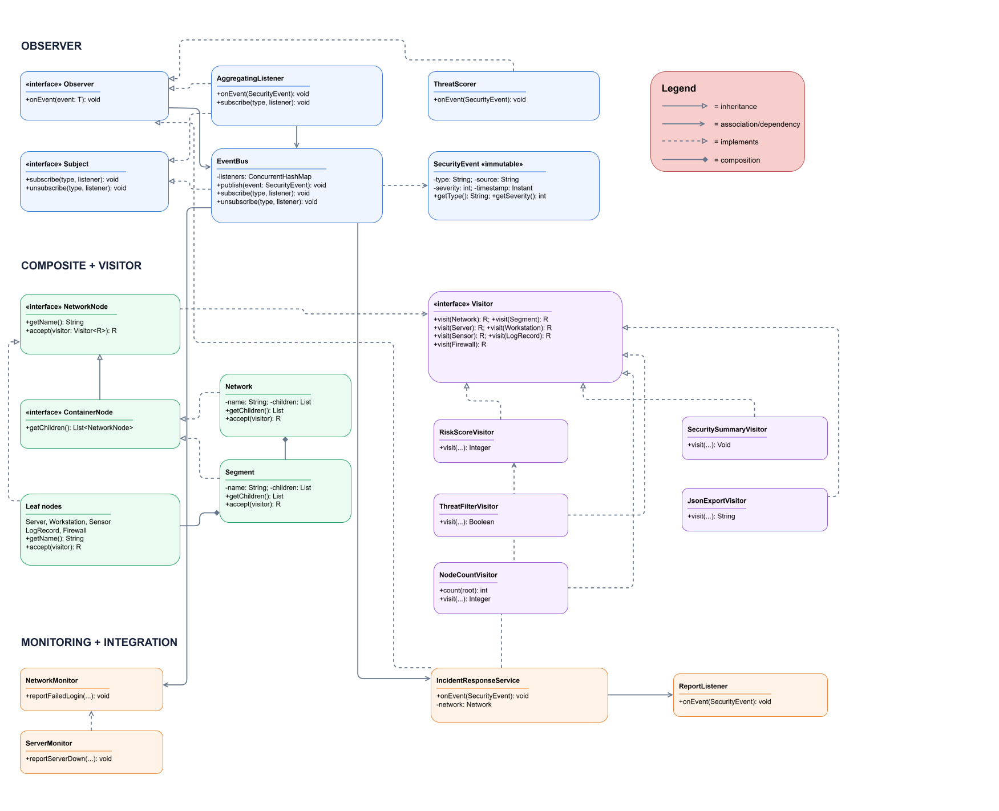

## SOC Monitoring System
## Overview
SOC Monitoring System is an application that simulates a Security Operations Center.
The system collects security events from multiple sources, detects threats, performs incident response, analyzes network infrastructure and generates security reports.

The project demonstrates three design patterns:
- Observer
- Composite
- Visitor

It also demonstrates multithreading, thread-safe event processing and constructor-based dependency injection.

## Architecture
The project contains five packages:
- app — application entry point and composition root
- observer — generic event interfaces, immutable events and event distribution
- monitoring — event producers, listeners and incident response
- network — Composite network tree
- visitor — visitors and tree traversal

## Design Decisions

### Observer Pattern
The system uses generic Subject<T> and Observer<T> interfaces.
NetworkMonitor and ServerMonitor act as event producers. Listeners include ConsoleListener, AuditLogListener, ThreatScorer, AggregatingListener, IncidentResponseService and ReportListener.
The system uses the push model because the complete immutable SecurityEvent object is delivered directly to subscribers. This avoids requiring listeners to query the source.
Subscribers are registered by event type. ConcurrentHashMap and CopyOnWriteArrayList support concurrent event delivery and safe subscription changes during notification.
AggregatingListener acts as both Observer and Subject. It collects statistics and republishes them as AGGREGATED_REPORT events.

### Composite Pattern
The network is represented as a tree.
There are two container types:
- Network
- Segment

There are five leaf types:
- Server
- Workstation
- Sensor
- LogRecord
- Firewall

### Visitor Pattern
The project uses generic Visitor<R> and double dispatch through accept().
Visitors include:
- RiskScoreVisitor — numeric risk calculation
- SecuritySummaryVisitor — accumulated network statistics
- ThreatFilterVisitor — filtering network elements
- JsonExportVisitor — nested JSON export
- NodeCountVisitor — counting nodes

Traversal is managed externally by TreeTraversal. This keeps element classes focused on data and separates traversal from processing logic.
JsonExportVisitor recursively processes child elements to preserve JSON nesting.

### Observer and Visitor Integration
IncidentResponseService receives security events and locates the corresponding network element.
It executes RiskScoreVisitor on the related node or subtree rather than the entire network.
The result is published as a new INSPECTION_REPORT event.

### Concurrency
The application uses a configurable ExecutorService thread pool.
Four producer tasks generate events concurrently.
Shared event registries and statistics use thread-safe Java collections and atomic counters.
The application waits for producer tasks to complete, shuts down the executor and waits for termination.

### Clean Code
Application is the composition root.
Dependencies are passed through constructors. Business components do not create their own EventBus or monitor dependencies.
Event types are represented by String constants rather than enums.

## Testing
JUnit 5 tests cover:
- Event subscriptions and unsubscriptions
- Event filtering by type
- Runtime subscription changes inside handlers
- Duplicate subscription prevention
- Immutable event validation
- Stress testing with four threads and 1,000 events per thread
- Risk calculations against manually calculated values
- Subtree calculations
- Security summaries
- Threat filtering
- Nested JSON export
- Visitor node counting
- Threat detection
- Aggregated event publication
- Observer–Visitor integration

The concurrency stress test expects exactly 4,000 delivered events.

## Trade-off Proof
### Adding a New Visitor
NodeCountVisitor.

Files to change:
- NodeCountVisitor
- Corresponding test file

No existing element class needs to change.

Cost: adding a new operation is inexpensive because the Visitor pattern keeps operations separate from elements.

### Adding a New Element Type
Example: Firewall.

Files to change:
- src/main/java/network/Firewall.java
- src/main/java/visitor/Visitor.java
- Existing visitor implementations
- Network construction in Application.java
- Corresponding tests

Cost: adding a new element type is more expensive because the Visitor interface and all existing visitors must support it.

## UML Class Diagram

## Conclusion
The SOC Monitoring System demonstrates the practical use of Observer, Visitor, and Composite. It supports concurrent event processing, network risk analysis, and automated incident reporting. 
The project highlights the importance of modularity, extensibility, and thread safety in security monitoring applications.